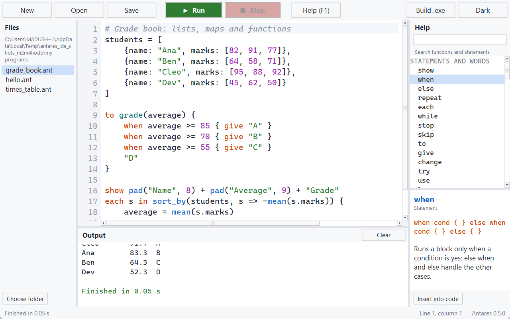

# Antares IDE

A small, friendly place to write and run [Antares](https://github.com/Madushan996/Antares-Programming-Language) programs, made for beginners.



- **Write.** Your code is coloured as you type, with line numbers. Indenting is automatic, brackets close themselves, and a list of words appears as you type: press **Tab** to accept one.
- **Run.** Press the green **Run** button (or **F5**) and see what your program shows in the panel below. When a program asks a question with `input()`, type your answer in the box that appears and press Enter. Programs that draw on the screen with `key()`, `draw()` and `clear()` (games, animations) open in their own window.
- **Fix problems.** When something goes wrong, the line is marked in red, the cursor jumps to it, and a hint in plain words explains what usually causes it. Click **Show me line N** to jump back.
- **Get help.** The help panel on the right explains every statement and all 100 built-in functions. Click on a word and press **F1** to see its help, or search, for example for "date" or "sort". **Insert into code** puts it in your program.
- **Learn from examples.** The **Examples** menu has eleven programs to try: a times table, a guessing game, a grade book, a word counter, a to-do list that remembers, the date and time, machine learning, a neural network, asking an AI model, and Snake.
- **Share your program.** **Build .exe** turns your program into a program file you can give to friends (this needs Rust, from rustup.rs).
- **Also included:** find and replace, go to line, comment lines out with Ctrl+/, bigger or smaller text, light and dark themes, recent files, and a panel listing the programs in your folder.

## Starting it

**Double-click `AntaresIDE.exe`.** It needs nothing else, except Antares itself.

If Antares isn't installed yet, the IDE shows the one line to paste into PowerShell to install it.

To run it from the source instead (Python 3.8 or newer, nothing else to install):

```
python antares_ide.py [program.ant]
```

or double-click `Start Antares IDE.bat`.

## Keyboard shortcuts

| Keys | Does |
|---|---|
| F5 | Run the program |
| Shift+F5 | Stop it |
| F1 | Help on the word under the cursor |
| Ctrl+S | Save |
| Ctrl+N, Ctrl+O | New, Open |
| Ctrl+Z, Ctrl+Y | Undo, Redo |
| Ctrl+F | Find and replace |
| Ctrl+G | Go to line |
| Ctrl+/ | Comment or uncomment lines |
| Ctrl+Space | Complete the word |
| Tab, Shift+Tab | Indent, unindent |
| Ctrl+=, Ctrl+- | Bigger, smaller text |
| Ctrl+B | Build a program file (.exe) |

## For developers

| File | What it is |
|---|---|
| `antares_ide.py` | The window: editor, output, help and files panels |
| `highlight.py` | Finds the parts of code to colour |
| `runner.py` | Finds Antares, runs programs, reads the problems they report |
| `help_data.py` | The help panel's reference, made from the Antares manual by `tools/make_help.py` |
| `examples/` | The programs in the Examples menu (the first line is the menu title) |
| `tools/` | `make_help.py`, `make_icon.py`, and `build_exe.py` (makes `AntaresIDE.exe` with PyInstaller) |

Check it with:

```
python -m unittest discover tests
python antares_ide.py --selftest [screenshot folder]
```

The second command opens the real window, types code, runs programs, answers `input()`, makes problems on purpose and checks how each is shown, then closes. It saves screenshots if you give it a folder.

When Antares gains new functions, run `python tools/make_help.py` to update the help panel from the manual.

Settings (theme, text size, recent files) are kept in `.antares_ide.json` in your home folder.
